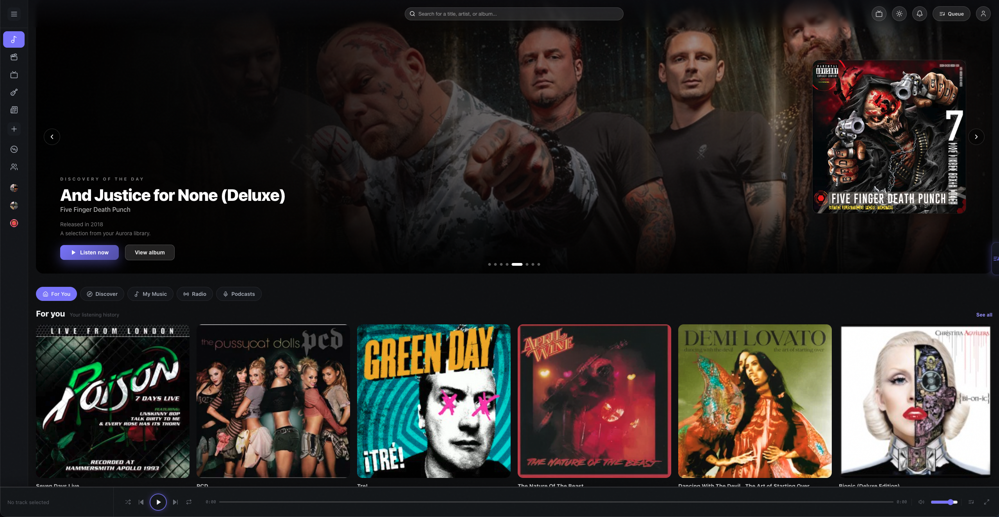
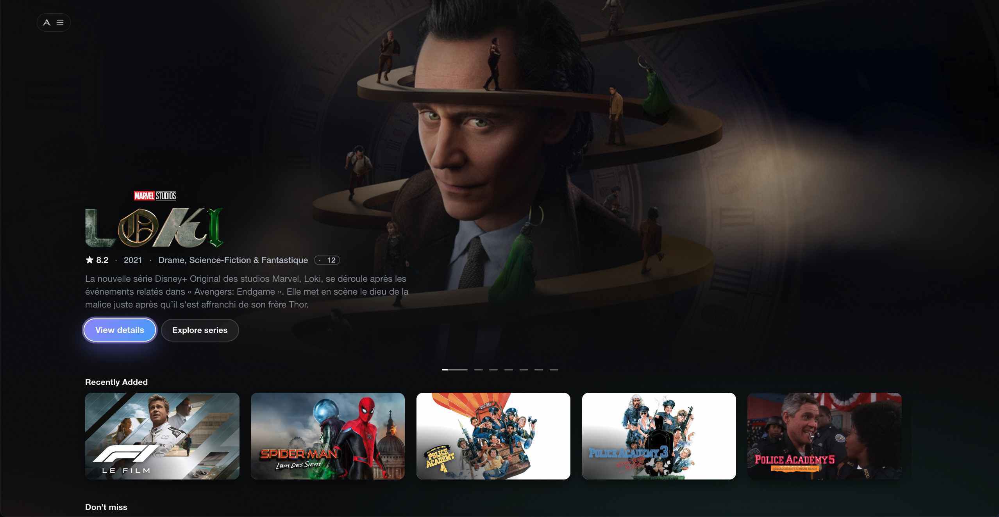

  

<h1 align="center">Aurora</h1>

<strong>Your media. Your server. Your world.</strong>

  
  
  
  
  

  A unified, self-hosted entertainment ecosystem for your personal media.

<strong>One server. Multiple experiences. Your media, your way.</strong>

  <a href="#the-aurora-ecosystem">Ecosystem</a> ·
  <a href="FEATURES.md">Features</a> ·
  <a href="#platforms--development-status">Platforms</a> ·
  <a href="#-discover-aurora">Screenshots</a> ·
  <a href="EARLY_ACCESS.md">Early Access</a> ·
  <a href="ROADMAP.md">Roadmap</a>

> **Private development — no public downloads yet.** Aurora is actively developed and tested privately. This repository is the official public information hub, not the application source-code repository. Feature availability and platform support may change before release.

  

---

## Welcome to Aurora

Aurora began with a simple idea: enjoying your own media should feel just as polished as using a modern streaming service — without giving up control of your library or your server.

What started as a music experience has evolved into a connected entertainment platform spanning **music, movies, TV series, live TV/IPTV, karaoke, guitar practice, news and more**.

Aurora combines a central media server with dedicated experiences for desktop, fullscreen viewing and Android. Its video playback architecture is evolving through **Aurora Cinema Engine**.

**Your library stays on infrastructure you control.** Aurora is designed for local-first use, with no mandatory cloud account for basic local access. Optional external services may be used for metadata, artwork or specific integrations.

## The Aurora ecosystem

| Component | Purpose | Current direction |
| --- | --- | --- |
| **Aurora Server** | Manages libraries, users, metadata, artwork, streaming and administration | Linux and macOS implementations under private testing; Windows server packaging planned |
| **Aurora Desktop** | Full-featured media browsing, playback and library experience | Functional in private development, with ongoing refinement |
| **Aurora Experience** | Immersive fullscreen, TV-style interface for large screens and remote-friendly navigation | Functional in private development, undergoing integration and polish |
| **Aurora Android** | Dedicated Android playback and navigation experience | Functional prototype/client undergoing private validation |
| **Aurora Cinema Engine** | Video playback and media-processing capabilities developed for Aurora | Active development and device-specific validation |

These components are being developed as **one connected platform**, not unrelated applications. Their capabilities, supported devices and distribution methods are still being finalized.

### One server. Different ways to enjoy it.

- **At your desk:** browse, organize and play through Aurora Desktop.
- **On a large screen:** explore your library in Aurora Experience's fullscreen interface.
- **On Android:** access a dedicated client designed for Android devices.
- **Behind the scenes:** Aurora Server powers library management and delivery, while Cinema Engine work improves the playback stack.

No public compatibility guarantee is made for particular TVs, phones, codecs or hardware at this stage.

---

## What you can do with Aurora

### 🎵 Music — a library worth exploring

Browse artists and albums, manage favorites and playlists, search across your collection, and enjoy artwork-rich playback. Aurora's music environment includes a full player, queue controls, local-library integration and ongoing work on advanced audio features.

### 🎬 Movies & TV series — a cinematic experience

Discover your personal movie and series collections through rich posters, backdrops, metadata and dedicated browsing pages. The movie and series interfaces are evolving with cinematic layouts, collections, artwork handling, progress tracking and more.

### 📺 Live TV & IPTV

Aurora includes work on live TV and M3U/IPTV workflows. Reliability, navigation and player behavior are still being refined; live TV functionality should not yet be considered final.

### 🎞️ Aurora Cinema Engine

Aurora Cinema Engine is the ongoing effort behind Aurora's video playback experience, including playback behavior, stream handling and platform-specific validation. The goal is smooth, dependable viewing across supported Aurora clients.

**Cinema Engine is under active development.** Supported formats, transcoding scenarios, hardware acceleration and performance will be documented after verification, rather than promised in advance.

> **Built for the Aurora ecosystem**
>
> Aurora Cinema Engine is being developed to improve video playback, stream handling and compatibility across Aurora's supported experiences.
>
> The goal is simple: make watching your personal media feel effortless.
>
> Playback capabilities and performance will be documented as validation progresses.

### 🎤 Lyrics & karaoke

Aurora integrates lyrics into the music experience, including local/synchronized lyrics work and a fullscreen karaoke interface. Additional party-oriented controls and refinements remain on the roadmap.

### 🎸 Guitar tabs & practice

The guitar section brings tablature and music practice into the same platform. Work includes AlphaTab-based notation and guitar tab experiences, with practice features evolving over time.

### 📰 News & discovery

Aurora's news experience explores music-related stories and editorial presentation, with continued improvements to its interface, sources and content workflows.

### 🔎 Search, artwork & metadata

Aurora aims to make a personal library easy to explore using search, rich artwork, media details and optional metadata integrations. Local artwork and metadata management are part of the ongoing work.

### ⚙️ Administration

Aurora Server includes administration tools for libraries, scanning, users, diagnostics and configuration. Installation, updates, recovery and packaging are being hardened before broader distribution.

For additional detail and evolving scope, see [FEATURES.md](FEATURES.md).

---

## Designed for a premium experience

Aurora puts the content first: immersive artwork, clean typography, thoughtful navigation, adaptable layouts and dynamic visual accents.

Desktop and fullscreen viewing are different experiences, but share the same design philosophy: **your media should feel like the main attraction, not a server control panel**.

## 📸 Discover Aurora

Aurora brings your personal media to life across multiple screens, with a consistent visual identity and experiences designed for each environment.

### Aurora Experience & Android

**Your entertainment. Your screen. Your experience.**

An immersive, fullscreen interface built for movies, TV series, live television, and more.

Designed for large screens and shared with Aurora Android, Aurora Experience brings the same cinematic atmosphere to your connected devices.

> **Development preview:** Screenshots are from private development builds. Interfaces may evolve before public release.

---

## Platforms & development status

**Important:** the statuses below describe *private project progress*, not public availability.

| Platform / experience | Status |
| --- | --- |
| Aurora Server — Linux | Private development and validation |
| Aurora Server — macOS (Apple Silicon) | Private development and validation |
| Aurora Server — Windows | Planned / upcoming packaging work |
| Aurora Desktop | Functional in private development |
| Aurora Experience (fullscreen) | Functional in private development |
| Aurora Android | Private development and device validation |
| Aurora Cinema Engine | Active development and playback testing |
| Additional platforms, including iOS / Apple TV | Long-term possibilities; no commitment or release date |

**No public installers, builds or download links are available at this time.**

### Installation

Aurora aims to make self-hosting approachable: install a server, add your media and enjoy it through supported clients. Platform packaging and upgrade safety are still being validated.

See [INSTALLATION.md](INSTALLATION.md) for the current public installation status. Do not treat internal development instructions as public installation guidance.

---

## 🔒 Local-first by design

Aurora is built around a straightforward principle: **your personal media library belongs under your control**.

- Personal libraries reside on infrastructure controlled by the server owner.
- Basic local use is designed not to require a mandatory Aurora cloud account.
- External metadata, artwork or other online services may be optional features.
- Multi-user access, permissions and secure server operation remain important design priorities.

Local-first does **not** mean every optional feature is entirely offline. Security and privacy details will continue to be validated before public distribution.

Read the [Privacy Policy](PRIVACY.md) and [Security Policy](SECURITY.md).

## 🌍 Language support

Aurora is being developed with **French and English** interface support. Localization is part of the desktop, server administration and media experiences, with continued consistency and quality work across clients.

---

## 🧪 Early Access

Aurora is **not publicly released**. If you are interested in testing a future build, sharing feedback or following development, you can read about the Early Access program and join the discussion.

- [Learn about Early Access](EARLY_ACCESS.md)

### Interested in Aurora?

Aurora is growing into a complete self-hosted entertainment ecosystem.

Follow its development, share your ideas, or express your interest in future private testing.

**[→ Join the Aurora Early Access Discussion](https://github.com/Whassup2k1/Aurora/discussions/1)**

*No public downloads or release dates have been announced.*

Participation in a discussion **does not grant immediate access** or guarantee selection for a private test.

## 🗺 Roadmap

Current priorities include:

1. Bringing Aurora Server, Desktop, Experience and Android together into a dependable ecosystem.
2. Continuing Aurora Cinema Engine playback development and validation.
3. Finishing platform packaging, installation, update and recovery testing.
4. Refining the movie, series, live TV and music experiences.
5. Strengthening cross-device navigation, localization, performance and reliability.
6. Preparing a carefully controlled Early Access program when the software is ready.

See [ROADMAP.md](ROADMAP.md) for the project roadmap. Milestones are subject to change.

---

## 💡 The Aurora philosophy

> Great personal media software should be beautiful, practical and under your control.

Aurora is independently developed with a focus on thoughtful design, local ownership and an enjoyable day-to-day experience. The goal isn't to accumulate features for their own sake; it's to create an ecosystem that feels consistent on every supported screen.

## 🤝 Community & feedback

Aurora's application code is developed privately, but feedback is welcome. Useful ways to contribute include:

- Interface and usability suggestions
- Bug reports from authorized testing
- Language and documentation feedback
- Device and hardware compatibility findings
- Thoughtful ideas that fit Aurora's direction

Use [GitHub Discussions](https://github.com/Whassup2k1/Aurora/discussions) for conversation and [GitHub Issues](https://github.com/Whassup2k1/Aurora/issues) for actionable reports where appropriate. Please do not publish credentials, private server addresses, license material or sensitive logs.

See [CONTRIBUTING.md](CONTRIBUTING.md) and [SUPPORT.md](SUPPORT.md).

## ❤️ Supporting Aurora

Aurora is an independent project. Voluntary ways to support continued development may be introduced in the future. There is currently no public purchase or donation requirement described by this README.

## 📚 Documentation

| Resource | Description |
| --- | --- |
| [Features](FEATURES.md) | Feature overview and areas under development |
| [Roadmap](ROADMAP.md) | Development direction and priorities |
| [Installation](INSTALLATION.md) | Installation and public availability status |
| [Early Access](EARLY_ACCESS.md) | Information for prospective testers |
| [Support](SUPPORT.md) | Questions, feedback and issue reporting |
| [Contributing](CONTRIBUTING.md) | Ways to help without access to private source code |
| [Privacy](PRIVACY.md) | Privacy approach |
| [Security](SECURITY.md) | Security guidance and vulnerability reporting |
| [EULA](EULA.md) | End-user license terms |

## ⚖️ Source code & licensing

**Aurora is proprietary software.** This public repository is intended for project information, documentation, discussion and feedback. It does **not** make Aurora's private application code open source or grant a license to copy or redistribute that code.

Any future builds will be distributed under their applicable terms. See [EULA.md](EULA.md) for further information.

---

<strong>AURORA</strong>

<em>Your media. Your server. Your world.</em>

